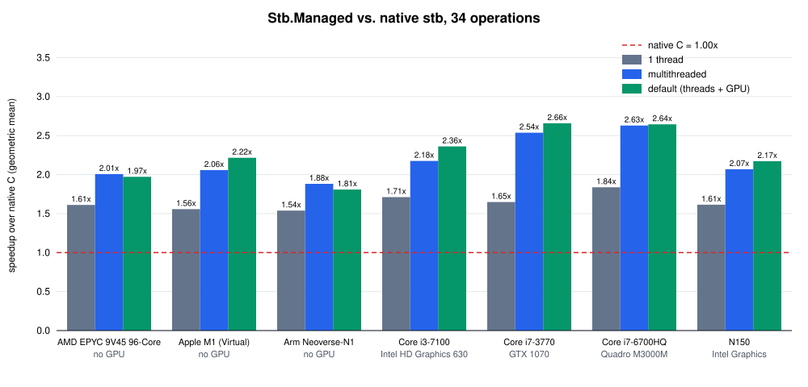

# Stb.Managed

[](https://www.nuget.org/packages/Stb.Managed)
[](https://github.com/sensboston/Stb.Managed/actions/workflows/build.yml)
[](https://dotnet.microsoft.com)
[](#performance)
[](LICENSE)

Fully managed C# versions of Sean Barrett's [stb](https://github.com/nothings/stb) libraries: image
loading and saving, resizing, TrueType font rasterization, rectangle packing, DXT texture
compression and Perlin noise. No native binaries, no `unsafe` code, safe on malformed files, and
faster than the C originals on most operations.

```
dotnet add package Stb.Managed
```



Geometric mean over 34 operations against the C originals on the same machine; details in
[Performance](#performance).

## stb

The stb libraries are the work of **Sean Barrett** and many contributors: small, self-contained,
public-domain C libraries that a large part of the games and graphics world builds on. The
algorithms, the structure of the API and the expected results all come from them; the native stb
build is the reference every test in this repository compares against. Thank you, Sean, for stb and
for giving it away.

## Why a managed version

- **No native code.** Nothing to build, ship or load per platform: the packages run wherever .NET
  runs, including containers, cloud functions, Unity, MonoGame and FNA (`netstandard2.1`).
- **Safe on hostile input.** Every read is bounds-checked; dimensions, pixel counts and allocations
  are capped by `StbLimits` before any work starts. A malformed file ends in a typed
  `StbException`, never in memory corruption. All seven libraries are
  fuzzed in CI every week, coverage-guided with libFuzzer and with mutations of the test corpus.
- **The same results.** The CPU code follows stb operation by operation, including the order of
  floating-point sums; decoders, encoders and resize produce the same bytes as the C library.
- **Faster.** Hot paths use `Vector128/256/512` and hardware intrinsics (AVX2, AVX-512, SSE, NEON),
  large operations split across threads, and resize and DXT compression can run on a GPU.

## Packages

| Package | stb library | |
|---|---|---|
| `Stb.Managed.Image` | `stb_image.h` | JPEG (baseline, progressive), PNG, BMP, TGA, GIF (animated), PSD, HDR, PIC, PNM; 8-bit, 16-bit and float |
| `Stb.Managed.ImageWrite` | `stb_image_write.h` | PNG, JPEG, BMP, TGA, HDR |
| `Stb.Managed.ImageResize` | `stb_image_resize2.h` | all pixel layouts and data types, filters, edge modes, alpha weighting, sub-rectangles |
| `Stb.Managed.TrueType` | `stb_truetype.h` | TrueType, OpenType CFF and collections; bitmaps, atlases, oversampling, SDF |
| `Stb.Managed.RectPack` | `stb_rect_pack.h` | skyline rectangle packing |
| `Stb.Managed.Dxt` | `stb_dxt.h` | BC1, BC3, BC4, BC5 |
| `Stb.Managed.Perlin` | `stb_perlin.h` | noise, fBm, ridge, turbulence; 2D grids |
| `Stb.Managed.Gpu` | | CUDA / OpenCL execution through [ILGPU](https://ilgpu.net) (net8.0, net10.0) |
| `Stb.Managed` | | all of the above |

Each library depends only on `Stb.Managed.Core`. Targets: .NET 8, .NET 10 and .NET Standard 2.1.

## Examples

```csharp
using Stb.Managed;

byte[] file = File.ReadAllBytes("photo.jpg");
ImageInfo info = StbImage.GetInfo(file);
ImageBuffer<byte> image = StbImage.Load(file, ColorComponents.RedGreenBlueAlpha);

ImageBuffer<byte> thumbnail = StbImageResize.Resize(image, 512, 341);
File.WriteAllBytes("thumbnail.png", StbImageWrite.WritePng(thumbnail));
File.WriteAllBytes("thumbnail.jpg", StbImageWrite.WriteJpeg(thumbnail, quality: 90));
```

```csharp
using Stb.Managed;
using Stb.Managed.Dxt;
using Stb.Managed.TrueType;

// BC3 texture from an RGBA image
byte[] bc3 = StbDxt.CompressImageToArray(image.ReadOnlyMemory, image.Width, image.Height, DxtFormat.Bc3);

// Glyph bitmap and signed distance field
StbTrueTypeFont font = StbTrueTypeFont.Load(File.ReadAllBytes("Roboto-Medium.ttf"));
float scale = font.ScaleForPixelHeight(48f);
byte[] sdf = font.GetCodepointSdf(scale, 'A', padding: 5, onEdgeValue: 180, pixelDistScale: 36f, out GlyphBitmapMetrics metrics);
```

Every operation also has span-based overloads that write into caller-provided buffers without
allocating (`StbImage.TryLoad`, `StbImageWrite.TryWritePng`, `StbImageResizer` for repeated resizes
of the same size, and so on).

## GPU and threads

Nothing has to be configured. Large operations use all cores. With the default `StbGpuMode.Auto`
the first GPU-capable call starts looking for a CUDA or OpenCL device in the background and keeps
running on the CPU meanwhile; once the GPU is ready, DXT compression and large resizes on a discrete
GPU go to it when that is faster than the CPU threads. Without a GPU, or without the
`Stb.Managed.Gpu` package, everything runs on the CPU.

```csharp
StbGpu.Mode = StbGpuMode.CpuOnly;                     // never use the GPU (or set STB_GPU_MODE=cpu)
StbGpu.Warmup();                                      // start the GPU now rather than on first use
var oneThread = new StbOptions { MaxDegreeOfParallelism = 1 };  // per call: single-threaded, like stb
```

GPU results can differ from the CPU in the last bit of a float or a rounded 8-bit value, and fully
transparent pixels lose their colour; the CPU path is the one that matches stb byte for byte.
`Stb.Managed.Gpu` also has its own API for work that stays on the GPU between steps (`StbGpuContext`,
`StbGpuImage<T>`, mipmap and DXT pyramids, batch SDF atlases).

## Performance

The benchmark runs 34 operations on real photographs and fonts through the pinned stb C sources
(built with `-O3 -march=<that CPU>`) and through Stb.Managed, on the same machine: desktop and mobile
x64, an Intel N150, an Arm Neoverse-N1 server and GitHub-hosted x64 and Apple M1 runners. Full
tables and per-operation charts are in [docs/benchmarks.md](docs/benchmarks.md).

Out of the box (all cores, GPU when present) Stb.Managed is 1.8–2.7 times as fast as stb (geometric
mean); on a single core, doing the same work, 1.5–1.8 times. Encoders, TrueType, Perlin noise and
nearly all decoders are faster than stb on every machine, including JPEG and PNG on Arm Neoverse. On a
single core resize is still slower than stb's hand-written SIMD (0.5–0.85×), DXT compression loses on
some CPUs (0.55–0.9×), and the Apple M1 runner is slower on small and progressive JPEGs; every case
below 0.9× is listed in the report.

Do not take our word for it: [bench/README.md](bench/README.md) explains, step by step, how to run
the same comparison on your own machine (three commands after installing .NET, CMake and a C
compiler).

## Exactness

- Decoders produce the same pixels as stb (JPEG uses stb's integer IDCT).
- Resize: 8- and 16-bit output equals `stb_image_resize2` byte for byte for every pixel layout (same
  coefficient packing and float summation order), and `Fp32` output equals it bit for bit.
- BMP, TGA, HDR, JPEG and PNG with `PngCompressionEngine.StbCompatible` are byte-identical to
  `stb_image_write`. The default PNG engine uses zlib: about 28% smaller files, and faster.
- DXT, Perlin and the PSD matte correction match stb built without FMA contraction.
- Multithreaded runs give the same output as one thread.

## Building and testing

```
dotnet build
dotnet test tests/Stb.Managed.Tests
```

The oracle tests compare against the native stb build in `native/` (CMake; `STB_ORACLE_PATH` points
to it); `dotnet run --project tools/Stb.Managed.Tools -- fetch-corpus` downloads the test images and fonts.

## License

MIT. The stb libraries are public domain or MIT; see [THIRD-PARTY-NOTICES.md](THIRD-PARTY-NOTICES.md).
