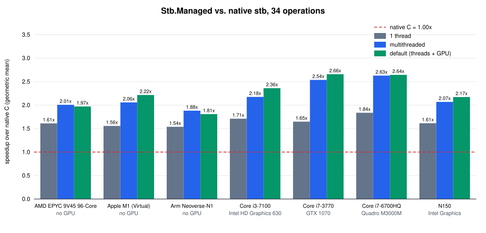
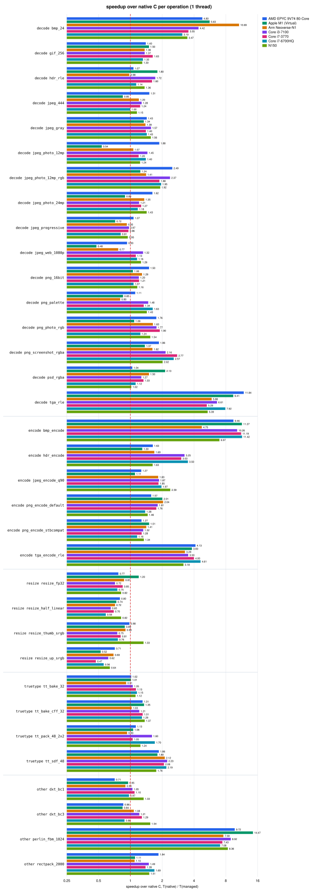

# Benchmarks

Stb.Managed compared with the native stb libraries on the same machine and the same inputs.
The numbers are speedups `T(native) / T(managed)` of the median time of each operation;
above 1.00 the managed code is faster. Generated by `Stb.Managed.Tools report` from the
`bench/results/<host>/` folders (or their zips) produced by `bench/run.ps1` / `bench/run.sh`.

- **native**: the pinned stb C sources, Release build, one thread; the compiler and flags
  are listed per machine below (taken from the native run header).
- **1 thread**: Stb.Managed with `MaxDegreeOfParallelism = 1` and no GPU: the same work as
  the native code.
- **all cores**: Stb.Managed with automatic parallelism (`MaxDegreeOfParallelism = 0`), no GPU.
- **default**: what a caller gets without configuration: all cores and `StbGpuMode.Auto`, which
  sends DXT compression, and large resizes on a discrete GPU, to a CUDA or OpenCL device when
  one is found (initialized before timing). GPU results can differ from the CPU in the last
  bit; on machines without a GPU this equals all cores.
- each case is warmed up for at least 3 runs (and at least 500 ms), then measured until at
  least 10 runs (and at least 1000 ms) on a monotonic clock; the tables show the median.
- `skipped` and `error` cases are shown as dashes and excluded from the geometric means.

## Machines

| CPU | ISA | OS | .NET | GPU | native build | 1 thread | all cores | default |
|---|---|---|---|---|---|---:|---:|---:|
| AMD EPYC 9V45 96-Core | SSE4.1, AVX2, AVX-512F | Ubuntu 26.04.1 LTS | .NET 10.0.15 | — | Clang 21.1.8 (6ubuntu1); -O3 -march=native | 1.61x | 2.01x | 1.97x |
| Apple M1 (Virtual) | NEON | macOS 26.7.2 | .NET 10.0.15 | — | Clang 21.0.0 (clang-2100.1.1.101); -O3 -march=native | 1.56x | 2.06x | 2.22x |
| Arm Neoverse-N1 | NEON | Ubuntu 24.04.5 LTS | .NET 10.0.15 | — | GCC 13.3.0; -O3 -march=native | 1.54x | 1.88x | 1.81x |
| Core i3-7100 | SSE4.1, AVX2 | Microsoft Windows 10.0.19045 | .NET 10.0.15 | Intel HD Graphics 630 (OpenCL) | Clang 17.0.6; -O3 -march=skylake | 1.71x | 2.18x | 2.36x |
| Core i7-3770 | SSE4.1 | Microsoft Windows 10.0.18363 | .NET 10.0.15 | GTX 1070 (Cuda) | Clang 17.0.6; -O3 -march=ivybridge | 1.65x | 2.54x | 2.66x |
| Core i7-6700HQ | SSE4.1, AVX2 | Microsoft Windows 10.0.19045 | .NET 10.0.15 | Quadro M3000M (Cuda) | Clang 17.0.6; -O3 -march=native | 1.84x | 2.63x | 2.64x |
| N150 | SSE4.1, AVX2 | Microsoft Windows 10.0.26300 | .NET 10.0.15 | Intel Graphics (OpenCL) | Clang 17.0.6; -O3 -march=alderlake | 1.61x | 2.07x | 2.17x |

## Where the managed code is slower

Operations that are more than 10% slower than the native code with one thread:

- **AMD EPYC 9V45 96-Core**: `dxt_bc1` 0.57x, `dxt_bc3` 0.71x, `resize_up_srgb` 0.76x, `resize_fp32` 0.76x
- **Apple M1 (Virtual)**: `resize_up_srgb` 0.47x, `resize_half_linear` 0.55x, `dxt_bc1` 0.56x, `jpeg_web_1080p` 0.66x, `resize_thumb_srgb` 0.69x, `dxt_bc3` 0.79x, `jpeg_progressive` 0.81x, `resize_fp32` 0.82x, `rectpack_2000` 0.89x
- **Arm Neoverse-N1**: `resize_up_srgb` 0.67x, `resize_half_linear` 0.68x, `resize_fp32` 0.80x, `resize_thumb_srgb` 0.82x, `dxt_bc1` 0.89x
- **Core i3-7100**: `resize_up_srgb` 0.64x, `resize_half_linear` 0.69x, `resize_fp32` 0.76x, `resize_thumb_srgb` 0.77x
- **Core i7-3770**: `resize_up_srgb` 0.48x, `resize_half_linear` 0.71x, `resize_thumb_srgb` 0.78x, `resize_fp32` 0.84x
- **Core i7-6700HQ**: `resize_up_srgb` 0.57x, `resize_fp32` 0.68x, `resize_half_linear` 0.70x, `resize_thumb_srgb` 0.79x
- **N150**: `resize_up_srgb` 0.68x, `resize_fp32` 0.80x, `resize_half_linear` 0.84x

## Operations

| operation | category | AMD EPYC 9V45 96-Core: native ms / 1 thread / all cores / default | Apple M1 (Virtual): native ms / 1 thread / all cores / default | Arm Neoverse-N1: native ms / 1 thread / all cores / default | Core i3-7100: native ms / 1 thread / all cores / default | Core i7-3770: native ms / 1 thread / all cores / default | Core i7-6700HQ: native ms / 1 thread / all cores / default | N150: native ms / 1 thread / all cores / default |
|---|---|---|---|---|---|---|---|---|
| `bmp_24` | decode | 3.559 / 4.72x (match) / 4.38x / 3.73x | 9.812 / 5.98x (match) / 8.46x / 8.10x | 17.137 / 10.38x (match) / 10.32x / 3.74x | 8.588 / 3.03x (match) / 4.13x / 4.93x | 10.482 / 3.42x (match) / 5.98x / 3.36x | 10.540 / 2.09x (match) / 2.05x / 6.67x | 9.380 / 2.36x (match) / 2.30x / 2.28x |
| `gif_256` | decode | 4.799 / 1.28x (match) / 1.43x / 1.44x | 7.443 / 1.57x (match) / 1.74x / 1.54x | 7.737 / 1.36x (match) / 1.25x / 1.36x | 6.687 / 1.36x (match) / 1.35x / 1.21x | 8.910 / 1.60x (match) / 1.52x / 1.48x | 8.223 / 1.40x (match) / 1.35x / 1.38x | 7.427 / 1.28x (match) / 1.27x / 1.24x |
| `hdr_rle` | decode | 9.102 / 1.06x (match) / 1.05x / 1.06x | 31.152 / 2.38x (match) / 2.12x / 1.99x | 17.204 / 0.98x (match) / 0.98x / 0.97x | 23.330 / 1.78x (match) / 1.73x / 1.70x | 29.270 / 1.77x (match) / 1.99x / 1.86x | 28.030 / 1.66x (match) / 1.74x / 1.52x | 24.775 / 1.35x (match) / 1.36x / 1.48x |
| `jpeg_444` | decode | 84.466 / 1.60x (match) / 1.66x / 1.52x | 136.826 / 0.91x (match) / 1.31x / 1.37x | 156.803 / 1.24x (match) / 1.23x / 1.32x | 110.666 / 1.14x (match) / 1.31x / 1.31x | 126.651 / 1.27x (match) / 1.28x / 1.29x | 136.866 / 1.34x (match) / 1.36x / 1.34x | 115.210 / 1.20x (match) / 1.17x / 1.22x |
| `jpeg_gray` | decode | 38.928 / 1.74x (match) / 1.71x / 1.64x | 76.702 / 1.48x (match) / 1.95x / 1.81x | 76.262 / 1.50x (match) / 1.49x / 1.47x | 57.378 / 1.57x (match) / 1.63x / 1.63x | 64.163 / 1.40x (match) / 1.46x / 1.48x | 71.191 / 1.71x (match) / 1.70x / 1.66x | 62.066 / 1.61x (match) / 1.62x / 1.64x |
| `jpeg_photo_12mp` | decode | 68.159 / 2.08x (match) / 2.17x / 2.11x | 116.908 / 1.21x (match) / 1.16x / 1.49x | 121.721 / 1.33x (match) / 1.53x / 1.51x | 79.513 / 1.54x (match) / 1.43x / 1.53x | 92.072 / 1.27x (match) / 1.41x / 1.43x | 103.748 / 1.65x (match) / 1.76x / 1.76x | 83.571 / 1.28x (match) / 1.35x / 1.34x |
| `jpeg_photo_12mp_rgb` | decode | 89.283 / 2.75x (match) / 2.91x / 2.82x | 149.404 / 1.97x (match) / 1.97x / 2.19x | 164.063 / 1.78x (match) / 2.08x / 2.02x | 118.136 / 2.22x (match) / 2.44x / 2.47x | 141.484 / 1.89x (match) / 1.94x / 2.35x | 147.108 / 2.32x (match) / 2.53x / 2.43x | 126.071 / 1.97x (match) / 2.20x / 2.16x |
| `jpeg_photo_24mp` | decode | 310.374 / 1.76x (match) / 4.60x / 4.43x | 618.924 / 1.75x (match) / 3.17x / 3.94x | 550.902 / 1.37x (match) / 2.56x / 2.56x | 373.669 / 1.32x (match) / 3.21x / 3.08x | 425.175 / 1.31x (match) / 4.73x / 4.66x | 476.379 / 1.42x (match) / 5.87x / 5.85x | 415.238 / 1.37x (match) / 3.51x / 3.58x |
| `jpeg_progressive` | decode | 168.369 / 1.12x (match) / 1.16x / 1.15x | 240.000 / 0.81x (match) / 1.14x / 1.21x | 250.950 / 1.00x (match) / 1.13x / 1.12x | 191.093 / 0.97x (match) / 1.00x / 1.01x | 212.046 / 0.94x (match) / 1.03x / 1.02x | 236.940 / 0.99x (match) / 1.06x / 1.05x | 210.151 / 0.96x (match) / 1.03x / 1.03x |
| `jpeg_web_1080p` | decode | 6.044 / 1.41x (match) / 0.95x / 0.95x | 11.980 / 0.66x (match) / 1.19x / 1.16x | 15.281 / 0.91x (match) / 0.90x / 0.91x | 11.239 / 1.36x (match) / 1.40x / 1.39x | 12.781 / 1.14x (match) / 1.13x / 1.13x | 14.320 / 1.25x (match) / 1.24x / 1.30x | 11.611 / 1.27x (match) / 1.30x / 1.33x |
| `png_16bit` | decode | 87.293 / 1.40x (match) / 1.55x / 1.62x | 140.218 / 1.25x (match) / 1.48x / 1.52x | 128.672 / 1.37x (match) / 1.60x / 1.35x | 98.964 / 1.20x (match) / 1.40x / 1.40x | 116.183 / 1.21x (match) / 1.42x / 1.42x | 123.228 / 1.21x (match) / 1.30x / 1.35x | 106.078 / 1.18x (match) / 1.24x / 1.26x |
| `png_palette` | decode | 10.008 / 1.62x (match) / 1.44x / 1.42x | 20.052 / 1.51x (match) / 1.64x / 1.66x | 15.936 / 1.52x (match) / 1.52x / 1.16x | 21.204 / 2.03x (match) / 2.15x / 2.36x | 19.429 / 1.90x (match) / 1.94x / 1.71x | 26.476 / 2.50x (match) / 2.28x / 2.30x | 21.993 / 2.17x (match) / 1.88x / 2.01x |
| `png_photo_rgb` | decode | 37.104 / 1.35x (match) / 1.86x / 1.91x | 92.883 / 2.18x (match) / 2.11x / 2.63x | 69.539 / 1.67x (match) / 2.44x / 2.44x | 54.462 / 1.70x (match) / 2.21x / 2.20x | 67.775 / 1.88x (match) / 2.36x / 2.34x | 67.122 / 1.79x (match) / 2.09x / 1.98x | 59.186 / 1.53x (match) / 2.01x / 2.03x |
| `png_screenshot_rgba` | decode | 3.918 / 1.49x (match) / 1.61x / 0.86x | 11.339 / 1.68x (match) / 1.86x / 1.66x | 8.062 / 1.55x (match) / 1.09x / 1.75x | 9.261 / 3.25x (match) / 3.69x / 3.62x | 10.925 / 2.06x (match) / 3.81x / 2.70x | 11.174 / 3.28x (match) / 1.75x / 1.90x | 9.325 / 2.06x (match) / 2.08x / 2.18x |
| `psd_rgba` | decode | 9.852 / 1.14x (differ) / 1.06x / 0.89x | 29.762 / 1.65x (differ) / 2.24x / 2.49x | 32.870 / 1.52x (differ) / 1.57x / 1.76x | 22.077 / 1.22x (differ) / 1.25x / 1.20x | 29.051 / 1.32x (match) / 1.28x / 1.32x | 26.998 / 1.29x (differ) / 1.25x / 1.08x | 19.984 / 1.01x (differ) / 1.02x / 1.03x |
| `tga_rle` | decode | 13.621 / 8.75x (match) / 7.89x / 8.25x | 20.046 / 9.50x (match) / 8.21x / 8.59x | 22.132 / 5.99x (match) / 5.97x / 3.35x | 23.369 / 5.11x (match) / 5.08x / 6.52x | 25.495 / 6.30x (match) / 6.64x / 5.17x | 45.643 / 13.07x (match) / 11.82x / 12.85x | 26.054 / 5.42x (match) / 5.44x / 5.90x |
| `bmp_encode` | encode | 27.351 / 5.46x (match) / 5.47x / 5.48x | 103.051 / 13.12x (match) / 14.43x / 15.59x | 39.243 / 4.78x (match) / 4.72x / 4.61x | 66.774 / 11.08x (match) / 11.34x / 11.41x | 86.892 / 11.13x (match) / 11.37x / 11.50x | 86.832 / 14.60x (match) / 14.38x / 14.64x | 70.848 / 6.93x (match) / 6.91x / 6.36x |
| `hdr_encode` | encode | 27.117 / 1.38x (match) / 1.44x / 1.47x | 48.796 / 1.54x (match) / 1.31x / 1.64x | 64.789 / 1.74x (match) / 1.72x / 1.73x | 81.942 / 3.25x (match) / 3.27x / 3.35x | 85.623 / 3.00x (match) / 3.05x / 2.95x | 114.179 / 3.80x (match) / 3.84x / 3.59x | 46.555 / 1.58x (match) / 1.62x / 1.62x |
| `jpeg_encode_q90` | encode | 95.400 / 1.25x (differ) / 1.45x / 1.47x | 182.630 / 1.48x (differ) / 1.70x / 2.06x | 306.695 / 1.81x (match) / 2.42x / 2.44x | 209.799 / 1.86x (differ) / 2.32x / 2.33x | 272.119 / 1.87x (match) / 2.81x / 2.76x | 284.472 / 2.06x (differ) / 2.46x / 2.82x | 292.877 / 2.38x (differ) / 3.18x / 3.16x |
| `png_encode_default` | encode | 1490.150 / 1.68x (differ) / 1.64x / 1.68x | 2410.448 / 2.25x (differ) / 1.96x / 2.28x | 2814.370 / 2.07x (differ) / 2.11x / 2.11x | 2211.228 / 1.84x (differ) / 1.86x / 1.87x | 2238.422 / 1.71x (differ) / 1.77x / 1.78x | 2611.087 / 1.80x (differ) / 1.84x / 1.83x | 2431.768 / 1.46x (differ) / 1.48x / 1.48x |
| `png_encode_stbcompat` | encode | 1494.168 / 1.34x (match) / 1.29x / 1.35x | 2724.464 / 1.64x (match) / 1.46x / 1.63x | 2814.227 / 1.43x (match) / 1.48x / 1.42x | 2212.306 / 1.33x (match) / 1.33x / 1.32x | 2246.244 / 1.21x (match) / 1.28x / 1.27x | 2608.789 / 1.25x (match) / 1.30x / 1.30x | 2455.287 / 1.35x (match) / 1.37x / 1.37x |
| `tga_encode_rle` | encode | 53.246 / 2.76x (match) / 2.79x / 2.89x | 124.376 / 3.01x (match) / 3.75x / 5.26x | 110.492 / 3.30x (match) / 3.29x / 3.28x | 95.685 / 3.57x (match) / 3.56x / 3.56x | 120.010 / 4.05x (match) / 4.04x / 4.05x | 194.948 / 6.12x (match) / 6.17x / 6.05x | 103.385 / 2.67x (match) / 2.99x / 3.14x |
| `resize_fp32` | resize | 61.564 / 0.76x (match) / 1.72x / 1.79x | 137.679 / 0.82x (match) / 1.96x / 2.11x | 196.443 / 0.80x (match) / 1.59x / 1.59x | 96.352 / 0.76x (match) / 1.12x / 1.25x | 177.766 / 0.84x (match) / 3.39x / 3.40x | 111.185 / 0.68x (match) / 2.24x / 1.81x | 133.461 / 0.80x (match) / 1.30x / 1.29x |
| `resize_half_linear` | resize | 58.348 / 0.95x (match) / 1.74x / 1.74x | 98.006 / 0.55x (match) / 0.79x / 1.20x | 212.842 / 0.68x (match) / 1.32x / 1.33x | 93.047 / 0.69x (match) / 1.32x / 1.33x | 186.912 / 0.71x (match) / 2.80x / 2.76x | 115.477 / 0.70x (match) / 2.65x / 1.88x | 136.663 / 0.84x (match) / 1.42x / 1.40x |
| `resize_thumb_srgb` | resize | 64.244 / 1.03x (match) / 1.97x / 2.05x | 137.960 / 0.69x (match) / 1.75x / 2.00x | 218.184 / 0.82x (match) / 1.59x / 1.58x | 103.187 / 0.77x (match) / 1.44x / 1.48x | 183.479 / 0.78x (match) / 3.03x / 2.56x | 131.525 / 0.79x (match) / 3.11x / 2.02x | 223.793 / 1.35x (match) / 2.47x / 2.50x |
| `resize_up_srgb` | resize | 26.978 / 0.76x (match) / 1.54x / 1.53x | 49.661 / 0.47x (match) / 0.95x / 1.10x | 120.917 / 0.67x (match) / 1.32x / 1.32x | 51.637 / 0.64x (match) / 1.39x / 1.35x | 80.759 / 0.48x (match) / 1.77x / 4.17x | 62.633 / 0.57x (match) / 2.71x / 1.98x | 71.373 / 0.68x (match) / 1.45x / 1.33x |
| `tt_bake_32` | truetype | 0.106 / 1.01x (match) / 1.02x / 1.06x | 0.215 / 0.97x (match) / 1.10x / 1.02x | 0.311 / 0.91x (match) / 0.91x / 0.92x | 0.380 / 1.12x (match) / 1.09x / 1.12x | 0.387 / 1.12x (match) / 1.13x / 1.11x | 0.450 / 1.17x (match) / 1.11x / 0.91x | 0.345 / 1.09x (match) / 1.08x / 1.09x |
| `tt_bake_cff_32` | truetype | 0.267 / 1.20x (match) / 1.15x / 1.19x | 0.583 / 1.35x (match) / 1.48x / 1.34x | 0.573 / 1.03x (match) / 1.03x / 1.03x | 0.653 / 1.25x (match) / 1.24x / 1.25x | 0.745 / 1.34x (match) / 1.31x / 1.30x | 0.839 / 1.30x (match) / 1.32x / 1.30x | 0.669 / 1.33x (match) / 1.27x / 1.33x |
| `tt_pack_48_2x2` | truetype | 0.753 / 0.94x (match) / 2.10x / 2.09x | 0.947 / 0.92x (match) / 1.34x / 1.18x | 1.529 / 0.93x (match) / 1.75x / 1.77x | 2.099 / 1.59x (match) / 3.31x / 3.28x | 1.733 / 1.08x (match) / 2.77x / 3.42x | 2.570 / 1.63x (match) / 4.24x / 4.18x | 1.956 / 1.35x (match) / 3.41x / 3.37x |
| `tt_sdf_48` | truetype | 7.129 / 1.93x (match) / 1.81x / 1.87x | 10.560 / 1.47x (match) / 1.54x / 1.84x | 14.259 / 2.13x (match) / 2.12x / 2.11x | 13.613 / 2.22x (match) / 2.21x / 2.21x | 17.075 / 2.19x (match) / 2.17x / 2.20x | 16.750 / 2.21x (match) / 2.20x / 1.72x | 13.685 / 1.77x (match) / 1.77x / 1.42x |
| `dxt_bc1` | other | 110.687 / 0.57x (differ) / 1.74x / 1.83x | 169.267 / 0.56x (differ) / 1.61x / 1.68x | 255.526 / 0.89x (differ) / 1.78x / 1.77x | 272.700 / 1.05x (differ) / 2.72x / 9.07x | 301.401 / 1.09x (differ) / 5.05x / 13.63x | 333.443 / 1.06x (differ) / 5.23x / 10.24x | 396.324 / 1.35x (differ) / 4.30x / 10.01x |
| `dxt_bc3` | other | 139.006 / 0.71x (differ) / 2.19x / 2.21x | 225.052 / 0.79x (differ) / 2.51x / 2.21x | 312.040 / 1.07x (differ) / 2.13x / 2.15x | 321.801 / 1.22x (differ) / 3.10x / 9.43x | 364.556 / 1.23x (differ) / 5.92x / 15.06x | 410.934 / 1.29x (differ) / 6.24x / 11.89x | 457.652 / 1.53x (differ) / 4.66x / 10.24x |
| `perlin_fbm_1024` | other | 79.624 / 12.91x (differ) / 24.86x / 26.35x | 143.539 / 14.22x (differ) / 28.07x / 31.54x | 166.057 / 7.59x (differ) / 14.86x / 15.12x | 126.935 / 8.90x (differ) / 20.71x / 20.11x | 136.179 / 7.13x (differ) / 31.82x / 30.88x | 155.212 / 8.94x (differ) / 35.64x / 34.79x | 139.280 / 8.39x (differ) / 25.69x / 25.37x |
| `rectpack_2000` | other | 0.429 / 2.22x (match) / 2.25x / 2.32x | 0.456 / 0.89x (match) / 0.96x / 1.07x | 0.745 / 1.07x (match) / 1.07x / 1.10x | 0.757 / 1.51x (match) / 1.50x / 1.49x | 0.815 / 1.40x (match) / 1.37x / 1.40x | 1.160 / 1.89x (match) / 1.92x / 1.28x | 0.840 / 1.58x (match) / 1.61x / 1.56x |

`match` / `differ` compares the FNV-1a-64 output checksum of the native run with the managed
one-thread run. A difference is expected for the PNG `engine=default` case (the managed default
encoder is zlib-based, not stb's own) and for operations with float arithmetic (DXT, Perlin,
JPEG encode, the PSD matte correction) where the native compiler folds multiplies and adds into
FMA instructions; it is a diagnostic, not a failure.
## Managed only

The `*_into` cases decode directly into caller-provided buffers, which the stb API has no
equivalent for, so there is no native counterpart and no speedup. Times are medians in ms.
| operation | AMD EPYC 9V45 96-Core: 1 thread / all cores / default | Apple M1 (Virtual): 1 thread / all cores / default | Arm Neoverse-N1: 1 thread / all cores / default | Core i3-7100: 1 thread / all cores / default | Core i7-3770: 1 thread / all cores / default | Core i7-6700HQ: 1 thread / all cores / default | N150: 1 thread / all cores / default |
|---|---|---|---|---|---|---|---|
| `bmp_24_into` | 0.332 / 0.339 / 0.358 | 0.951 / 1.029 / 0.983 | 1.100 / 1.133 / 1.107 | 1.131 / 1.135 / 1.138 | 1.539 / 1.491 / 1.517 | 1.035 / 1.027 / 1.024 | 1.819 / 1.818 / 1.808 |
| `gif_256_into` | 3.081 / 3.311 / 3.119 | 4.235 / 4.282 / 4.144 | 5.590 / 6.041 / 5.583 | 4.777 / 4.734 / 4.750 | 5.462 / 5.411 / 5.567 | 5.697 / 5.685 / 5.815 | 5.496 / 5.406 / 5.477 |
| `hdr_rle_into` | 7.568 / 7.732 / 7.830 | 11.741 / 12.241 / 12.432 | 16.909 / 16.955 / 17.112 | 11.983 / 13.861 / 12.021 | 13.319 / 13.162 / 13.196 | 14.657 / 14.491 / 17.805 | 14.440 / 14.475 / 14.517 |
| `jpeg_444_into` | 50.501 / 49.956 / 53.920 | 120.157 / 108.384 / 85.787 | 124.571 / 125.555 / 125.708 | 82.789 / 82.387 / 83.432 | 95.728 / 96.362 / 95.552 | 100.302 / 98.547 / 101.243 | 88.605 / 88.409 / 88.519 |
| `jpeg_gray_into` | 22.458 / 23.461 / 22.455 | 42.315 / 49.504 / 45.777 | 50.258 / 49.995 / 50.612 | 34.370 / 34.920 / 34.915 | 43.766 / 43.722 / 42.823 | 41.237 / 41.791 / 42.749 | 37.134 / 37.786 / 37.495 |
| `jpeg_photo_12mp_into` | 31.650 / 30.856 / 32.093 | 59.741 / 86.286 / 79.910 | 89.694 / 90.067 / 89.725 | 49.601 / 48.920 / 50.269 | 68.559 / 79.413 / 67.065 | 60.443 / 60.220 / 65.443 | 57.861 / 58.167 / 57.713 |
| `jpeg_photo_12mp_rgb_into` | 31.006 / 31.002 / 32.379 | 57.482 / 70.313 / 56.488 | 91.520 / 91.716 / 91.470 | 50.663 / 50.062 / 56.991 | 67.664 / 67.388 / 67.008 | 61.554 / 69.478 / 61.341 | 57.908 / 58.179 / 57.848 |
| `jpeg_photo_24mp_into` | 173.889 / 65.343 / 65.768 | 334.243 / 193.437 / 144.789 | 369.377 / 210.105 / 211.114 | 271.123 / 112.388 / 115.462 | 309.055 / 84.665 / 84.675 | 327.043 / 79.173 / 78.718 | 293.480 / 112.095 / 111.419 |
| `jpeg_progressive_into` | 148.484 / 145.917 / 145.447 | 258.946 / 198.438 / 189.318 | 249.753 / 233.309 / 236.006 | 211.062 / 190.477 / 190.262 | 221.549 / 211.741 / 212.435 | 241.043 / 227.691 / 225.560 | 209.261 / 201.332 / 204.547 |
| `jpeg_web_1080p_into` | 3.881 / 3.908 / 4.006 | 8.270 / 8.462 / 8.818 | 13.444 / 13.465 / 13.504 | 6.569 / 6.516 / 6.603 | 9.633 / 9.538 / 9.486 | 7.830 / 7.918 / 7.938 | 8.063 / 8.093 / 8.091 |
| `png_16bit_into` | 56.706 / 57.535 / 56.435 | 91.873 / 85.103 / 89.847 | 93.359 / 80.986 / 92.765 | 78.538 / 70.509 / 70.942 | 92.271 / 81.560 / 81.990 | 94.520 / 94.558 / 91.683 | 89.952 / 84.905 / 84.273 |
| `png_palette_into` | 6.184 / 6.304 / 6.273 | 12.862 / 12.896 / 10.669 | 10.353 / 10.320 / 10.955 | 8.694 / 9.435 / 8.631 | 9.939 / 9.813 / 9.914 | 10.236 / 11.394 / 11.203 | 9.987 / 10.500 / 10.458 |
| `png_photo_rgb_into` | 25.114 / 19.749 / 18.989 | 46.851 / 38.417 / 34.687 | 40.765 / 28.529 / 28.505 | 30.509 / 24.551 / 24.657 | 35.883 / 28.656 / 28.775 | 36.396 / 31.763 / 32.859 | 38.587 / 31.631 / 30.098 |
| `png_screenshot_rgba_into` | 2.418 / 2.164 / 2.075 | 4.804 / 5.831 / 5.274 | 5.006 / 4.401 / 4.402 | 2.676 / 1.764 / 1.772 | 3.553 / 2.314 / 2.388 | 3.228 / 2.381 / 2.427 | 4.544 / 3.712 / 3.729 |
| `psd_rgba_into` | 8.209 / 8.736 / 8.708 | 15.622 / 11.995 / 12.623 | 17.427 / 17.460 / 17.356 | 16.659 / 16.456 / 16.445 | 20.928 / 21.316 / 20.763 | 19.325 / 19.438 / 20.744 | 18.978 / 18.123 / 18.112 |
| `tga_rle_into` | 1.201 / 1.336 / 1.265 | 1.986 / 1.777 / 1.928 | 2.850 / 2.838 / 2.825 | 2.810 / 2.799 / 3.198 | 3.166 / 3.074 / 3.091 | 2.877 / 2.926 / 2.944 | 3.735 / 3.733 / 3.729 |
